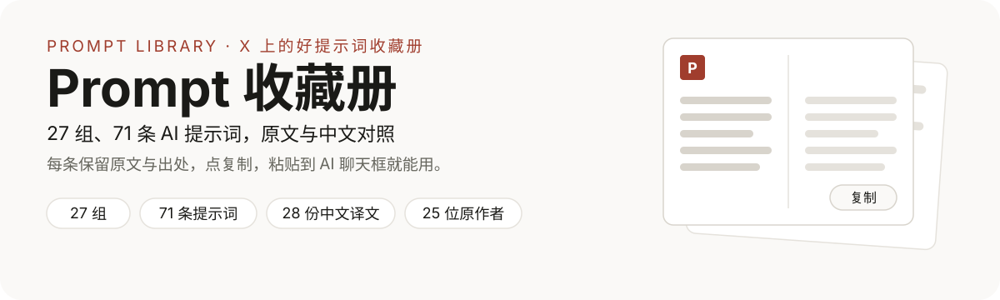
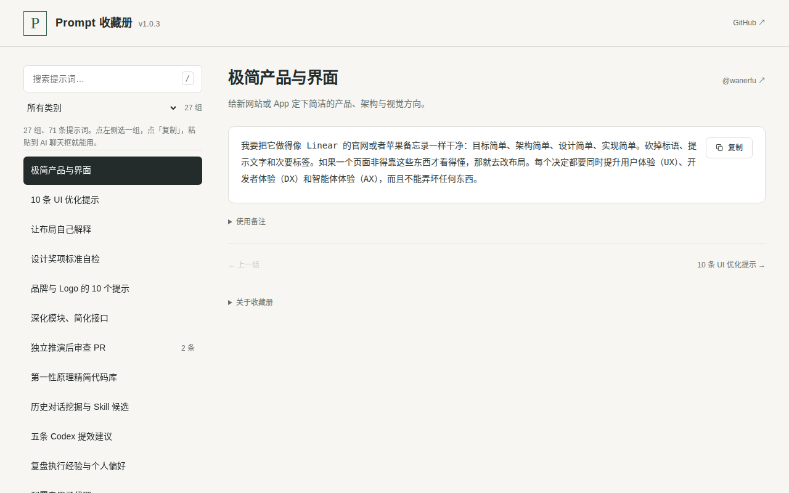
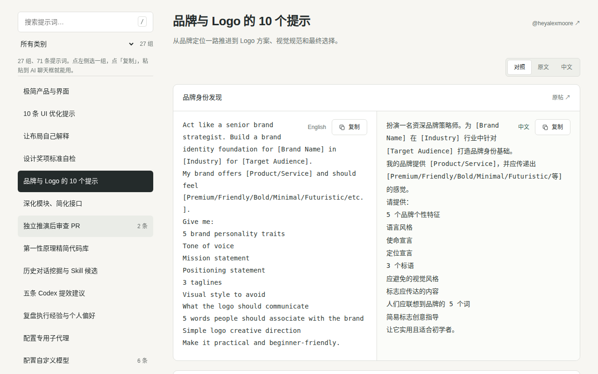

<p align="right"><a href="README.md">中文</a></p>

<p align="center">
  
</p>

<p align="center">
  <a href="https://xiaosang.cc/x-prompt-library/">▶ Browse Online</a>
  ·
  <a href="https://github.com/holynova/x-prompt-library">GitHub Repository</a>
</p>

Prompt Library collects 71 practical AI prompts in 27 groups, all sourced from public posts on X: interface design, branding, code review, agent workflows, image & video, learning and research. Every prompt keeps its original text and source link; 28 include a Chinese translation. Browse by category, search the full text, compare original vs. translation, and copy each version independently. A purely static single page — no backend.

## Screenshots

<p align="center">
  
</p>

<p align="center">
  
</p>

## Content

27 groups, 71 prompts, 28 translations (counts asserted by `scripts/check.mjs`):

| Category | Groups | Examples |
| :--- | :---: | :--- |
| 图像与视频创作 (Image & Video) | 9 | Seedance camera-movement prompt guide, turning one portrait into a 20-panel film storyboard, a 15-second motion-design portfolio |
| 个人工作流与 Agent (Personal Workflow & Agents) | 6 | Configuring dedicated sub-agents, five Codex productivity tips, reviewing execution experience and personal preferences |
| 界面与品牌设计 (Interface & Brand Design) | 5 | Minimalist products & interfaces, 10 UI optimization tips, 10 prompts for brand & logo |
| 代码质量 (Code Quality) | 3 | Reviewing a PR after independent reasoning, slimming a codebase from first principles, deepening modules, simplifying interfaces |
| 学习、研究与表达 (Learning, Research & Expression) | 2 | Explaining the same knowledge in multiple formats, 10 NotebookLM prompts |
| 设备与历史排障 (Device & Historical Troubleshooting) | 2 | Reducing ads and interruptions on Android, tracing Codex TRACE logs written to disk |

25 original authors in total; every group credits its author and links to the source post on X, and prompt text remains attributed to its original authors. This collection was verified on 2026-11-08; model names and historical troubleshooting notes keep their original context.

## Features

- **Side-by-side original/translation**: original and translation side by side, with three view modes — 「对照」 ("Compare") / 「原文」 ("Original") / 「中文」 ("Chinese"); English and Chinese each have their own copy button.
- **Search & filter**: full-text search (press `/` to focus the search box) plus category filters; pick a group from the left directory and flip between groups.
- **Copy per prompt**: every prompt copies independently; a manual-copy fallback covers browsers where clipboard access is blocked.
- **Works offline**: data is embedded as JSON in the single page — open `public/index.html` directly to browse offline.

## Run Locally

```bash
npm run dev     # python3 -m http.server 4312 --directory public
# Open http://localhost:4312/
```

Check data integrity (group, prompt, and translation counts, links, version):

```bash
npm run check   # node scripts/check.mjs
```

## Tech

- Pure static single page: `public/index.html` holds styles, logic, and all data (27 groups embedded in `<script id="library-data" type="application/json">`) — zero build, zero dependencies.
- Data validation: `scripts/check.mjs` asserts 27 groups / 71 prompts / 28 translations, unique group IDs, an `https://x.com/` source link per group, and a translation for every non-Chinese prompt, plus JS syntax and version-consistency checks.

```
public/index.html       Single-page app: styles + logic + embedded JSON data (27 groups)
scripts/check.mjs       Data integrity checks (counts / translations / links / version)
scripts/deploy.mjs      Publishing script (maintainers only)
scripts/sync-portfolio.mjs  Sync script (maintainers only)
assets/                 Old screenshots and QR codes (kept)
```
