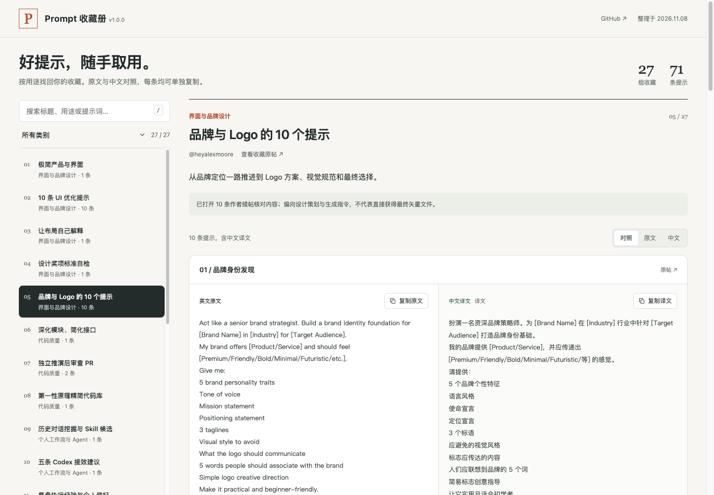

# Prompt 收藏册 / Prompt Library

中文：27 组、71 条实用 AI 提示词，涵盖界面设计、品牌、代码审查、Agent 工作流、图像视频和学习研究。保留原文与出处，附 28 份中文译文，支持分类、全文搜索、语言对照及逐条复制。纯静态单页，无需后端。

English: A static library of 71 AI prompts in 27 collections, with original text, source links and 28 Chinese translations. Browse by category, search the full text, compare languages and copy each version independently. No backend required.



## 在线体验 / Live Demo

- [Cloudflare Demo](https://x-prompt-library.xiaosang.cc/)
- [GitHub Repo](https://github.com/holynova/x-prompt-library)


## 本地运行 / Run locally

```bash
npm ci
npm run dev
```

Open http://localhost:4312/ . The self-contained `public/index.html` can also be opened offline; automatic clipboard access depends on browser permissions, with a manual-copy fallback.

## 检查与发布 / Check & deploy

```bash
npm run check
npm run deploy:check
npm run deploy
```

Cloudflare Workers Static Assets · Custom Domain: `x-prompt-library.xiaosang.cc`.

源码与配置统一维护在 `main`；从同一提交在本地手动部署，不使用 Cloudflare 自动部署工作流。

Source and deployment configuration share `main`; deploy manually from the same commit. Prompt text remains attributed to its original authors. The collection was checked on 2026-11-08; model names and historical troubleshooting instructions retain their original context.
