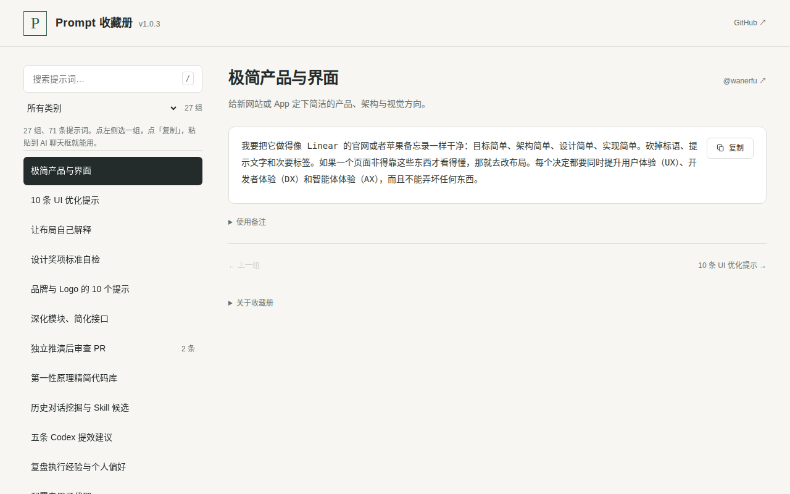
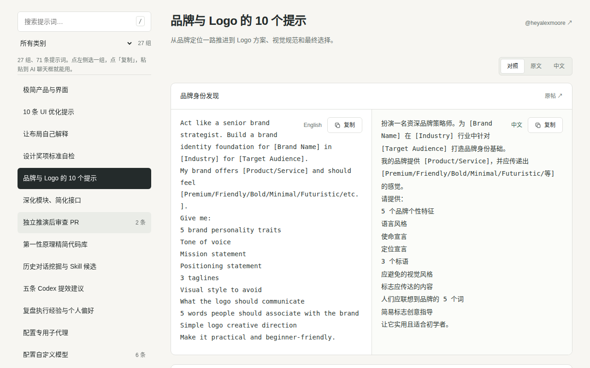

<p align="right"><a href="README.en.md">English</a></p>

<p align="center">
  
</p>

<p align="center">
  <a href="https://xiaosang.cc/x-prompt-library/">▶ 在线浏览</a>
  ·
  <a href="https://github.com/holynova/x-prompt-library">GitHub 仓库</a>
</p>

Prompt 收藏册收录了 27 组、71 条实用的 AI 提示词，全部来自 X 上原作者的公开分享：界面设计、品牌、代码审查、Agent 工作流、图像视频、学习研究。每条保留原文与出处链接，28 条附中文译文；支持分类筛选、全文搜索、原文/译文对照及逐条独立复制。纯静态单页，无需后端。

## 截图

<p align="center">
  
</p>

<p align="center">
  
</p>

## 内容

27 组、71 条、28 份译文（数量由 `scripts/check.mjs` 断言校验）：

| 分类 | 组数 | 举例 |
| :--- | :---: | :--- |
| 图像与视频创作 | 9 | Seedance 运镜提示词指南、一张人物图生成 20 格电影分镜、15 秒动态设计作品集 |
| 个人工作流与 Agent | 6 | 配置专用子代理、五条 Codex 提效建议、复盘执行经验与个人偏好 |
| 界面与品牌设计 | 5 | 极简产品与界面、10 条 UI 优化提示、品牌与 Logo 的 10 个提示 |
| 代码质量 | 3 | 独立推演后审查 PR、第一性原理精简代码库、深化模块、简化接口 |
| 学习、研究与表达 | 2 | 多种格式解释同一知识、NotebookLM 的 10 个提示 |
| 设备与历史排障 | 2 | Android 减少广告与打扰、Codex TRACE 日志写盘排查 |

共 25 位原作者；每组都标注作者与 X 原帖链接，提示词文字归原作者所有。本收藏册于 2026-11-08 核对；模型名称与历史排障说明保留原始语境。

## 功能

- **中英对照**：原文与译文左右并排，可切「对照 / 原文 / 中文」三种视图；英文与中文各有独立的复制按钮。
- **搜索与筛选**：全文搜索（按 `/` 聚焦搜索框）+ 按分类筛选；左侧目录点选切换组，组间可上下翻页。
- **逐条复制**：每条提示词独立复制；剪贴板权限受限时有手动复制兜底。
- **离线可用**：数据以 JSON 内嵌在单页里，`public/index.html` 直接打开就能离线浏览。

## 本地运行

```bash
npm run dev     # python3 -m http.server 4312 --directory public
# 打开 http://localhost:4312/
```

检查数据完整性（组数、条数、译文数、链接、版本号）：

```bash
npm run check   # node scripts/check.mjs
```

## 技术

- 纯静态单页：`public/index.html` 一个文件包含样式、逻辑与全部数据（`<script id="library-data" type="application/json">` 内嵌 27 组数据），零构建、零依赖。
- 数据校验：`scripts/check.mjs` 断言 27 组 / 71 条 / 28 份译文、组 ID 唯一、每组都有 `https://x.com/` 出处链接、非中文提示词都有译文，并做 JS 语法检查与版本号一致性检查。

```
public/index.html       单页应用：样式 + 逻辑 + 内嵌 JSON 数据（27 组）
scripts/check.mjs       数据完整性校验（组数 / 条数 / 译文 / 链接 / 版本）
scripts/deploy.mjs      发布脚本（仅供维护者使用）
scripts/sync-portfolio.mjs  同步脚本（仅供维护者使用）
assets/                 旧截图与二维码（保留）
```
